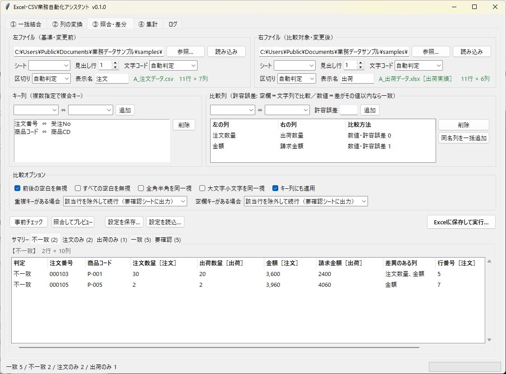

# Excel・CSV業務自動化ツール 制作実績

複数の Excel・CSV ファイルの **結合**、列の **整形・書式の統一**、2つの表の **照合（差分チェック）** を、
画面操作だけで行える Windows アプリの制作実績です。

> このリポジトリは紹介用のページ（GitHub Pages）とサンプルデータのみを公開しています。
> アプリ本体のソースコードは含まれていません。

**紹介ページ:** `index.html`（GitHub Pages で公開）



## できること

| 機能 | 内容 |
|---|---|
| ① 一括結合 | 店舗別・月別などに分かれたCSV・Excelを1つにまとめる。文字コードや列の順番の違いを自動でそろえる |
| ② 列の変換 | 列名の変更・並べ替え・削除、日付や金額の書き方の統一、番号の桁そろえ。設定を保存して毎回同じ処理を再現 |
| ③ 照合・差分チェック | 注文と出荷、新旧の名簿などを突き合わせ、「一致・不一致・片方だけ」を分類してExcelに出力。違うセルは赤く表示 |

## 主な特長

- Windows 用、インストール不要（exe）
- 元のファイルを書き換えない。処理ごとに結果レポートを自動保存
- コードの先頭の「0」を消さない。番号の重複・空欄を事前にチェック
- 自動テスト 219 件、画面操作の自動テスト 27 件、配布版（exe）の操作テスト 7 件にすべて合格

詳しい機能、Before/After の例、制約事項は紹介ページをご覧ください。

## サンプルデータ

`samples/input/`（入力）と `samples/output/`（出力結果）に、紹介ページの例で使ったデータを置いています。
**すべて架空のデータです。** 実在の企業・人物とは関係ありません。

## ご相談

ご相談・お問い合わせは、ご利用中のクラウドソーシングサイトのメッセージ機能からお送りください。

## ファイル構成

```
index.html            紹介ページ
assets/css/style.css  ページのデザイン
assets/img/           アプリの画面
samples/input/        サンプル入力データ
samples/output/       サンプル出力結果
```
